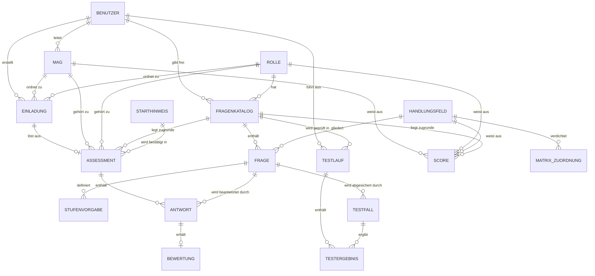

# Entity Model

Quelle: `docs/requirements.md`, Begriffe: `docs/glossary.md`. MAG (Scrum Team, Linienteam) und ROLLE sind getrennt; Scores und Einladungen verweisen auf beide.

## Entity Relationship Diagram

## Core

### MAG

Mitarbeitergruppe aus Scrum Team und Linienteam, der Teilnehmer und Scores zugeordnet werden.

| Attribute | Description | Data Type | Length/Precision | Validation Rules |
|-----------|-------------|-----------|------------------|------------------|
| id | Unique identifier | Long | 19 | Primary Key, Sequence |
| scrum_team | Name des Scrum Teams | String | 100 | Not Null |
| linienteam | Name des Linienteams | String | 100 | Not Null |
| teamleitung_id | Teamleitung, die die MAG betreut | Long | 19 | Optional, Foreign Key (BENUTZER.id) |

#### Constraints

- Die Kombination aus Scrum Team und Linienteam ist eindeutig (scrum_team, linienteam are unique together).

### ROLLE

Aufgabe eines Teilnehmers im Team, nach der Fragenkatalog und Auswertung getrennt werden.

| Attribute | Description | Data Type | Length/Precision | Validation Rules |
|-----------|-------------|-----------|------------------|------------------|
| id | Unique identifier | Long | 19 | Primary Key, Sequence |
| name | Name der Rolle, zum Beispiel Entwicklung, Test, Scrum Master, DevEx | String | 50 | Not Null, Unique |

### HANDLUNGSFELD

Eine der sechs Kompetenzdimensionen, die ein Assessment bewertet.

| Attribute | Description | Data Type | Length/Precision | Validation Rules |
|-----------|-------------|-----------|------------------|------------------|
| id | Unique identifier | Long | 19 | Primary Key, Sequence |
| nummer | Laufende Nummer 1 bis 6 | Integer | 10 | Not Null, Unique, Min: 1, Max: 6 |
| name | Name des Handlungsfelds | String | 100 | Not Null, Unique |
| fokus | Kurzbeschreibung des Fokus | String | 200 | Optional |

### FRAGENKATALOG

Version der Fragen einer Rolle mit Freigabestatus.

| Attribute | Description | Data Type | Length/Precision | Validation Rules |
|-----------|-------------|-----------|------------------|------------------|
| id | Unique identifier | Long | 19 | Primary Key, Sequence |
| rolle_id | Rolle, für die der Katalog gilt | Long | 19 | Not Null, Foreign Key (ROLLE.id) |
| version | Versionsnummer je Rolle | Integer | 10 | Not Null, Min: 1, Max: 9999 |
| status | Freigabestatus | String | 20 | Not Null, Values: Entwurf, Freigegeben, Archiviert |
| erstellt_am | Zeitpunkt der Erstellung | DateTime | - | Not Null |
| freigegeben_am | Zeitpunkt der Freigabe | DateTime | - | Optional |
| freigegeben_von_id | Administrator, der freigegeben hat | Long | 19 | Optional, Foreign Key (BENUTZER.id) |

#### Constraints

- Die Version ist je Rolle eindeutig (rolle_id, version are unique together).
- Je Rolle hat höchstens ein Fragenkatalog den Status Freigegeben.
- Freigegeben_am und freigegeben_von_id sind genau dann gesetzt, wenn der Status Freigegeben oder Archiviert ist.

### FRAGE

Einzelne Frage eines Fragenkatalogs, die zu genau einem Handlungsfeld gehört.

| Attribute | Description | Data Type | Length/Precision | Validation Rules |
|-----------|-------------|-----------|------------------|------------------|
| id | Unique identifier | Long | 19 | Primary Key, Sequence |
| fragenkatalog_id | Fragenkatalog der Frage | Long | 19 | Not Null, Foreign Key (FRAGENKATALOG.id) |
| handlungsfeld_id | Handlungsfeld der Frage | Long | 19 | Not Null, Foreign Key (HANDLUNGSFELD.id) |
| text | Wortlaut der Frage | String | 500 | Not Null |
| position | Reihenfolge im Fragenkatalog | Integer | 10 | Not Null, Min: 1, Max: 999 |

#### Constraints

- Die Position ist je Fragenkatalog eindeutig (fragenkatalog_id, position are unique together).

### STUFENVORGABE

Eintrag des Entscheidungsmodells: Beschreibung der Antwort, die einer Stufe einer Frage entspricht.

| Attribute | Description | Data Type | Length/Precision | Validation Rules |
|-----------|-------------|-----------|------------------|------------------|
| id | Unique identifier | Long | 19 | Primary Key, Sequence |
| frage_id | Frage, für die die Vorgabe gilt | Long | 19 | Not Null, Foreign Key (FRAGE.id) |
| stufe | Stufe 0 bis 5 | Integer | 10 | Not Null, Min: 0, Max: 5 |
| beschreibung | Merkmale einer Antwort dieser Stufe | String | 500 | Not Null |

#### Constraints

- Je Frage gibt es genau eine Vorgabe je Stufe (frage_id, stufe are unique together).

### ASSESSMENT

Ein Durchlauf eines Teilnehmers; wird zusammen mit den Antworten gelöscht und trägt keinen Personenbezug.

| Attribute | Description | Data Type | Length/Precision | Validation Rules |
|-----------|-------------|-----------|------------------|------------------|
| id | Unique identifier | Long | 19 | Primary Key, Sequence |
| einladung_id | Einladung, mit der das Assessment gestartet wurde | Long | 19 | Not Null, Unique, Foreign Key (EINLADUNG.id) |
| mag_id | MAG der Einladung | Long | 19 | Not Null, Foreign Key (MAG.id) |
| rolle_id | Rolle der Einladung | Long | 19 | Not Null, Foreign Key (ROLLE.id) |
| fragenkatalog_id | Verwendeter Fragenkatalog | Long | 19 | Not Null, Foreign Key (FRAGENKATALOG.id) |
| starthinweis_id | Bestätigter Starthinweis | Long | 19 | Not Null, Foreign Key (STARTHINWEIS.id) |
| status | Stand des Assessments | String | 20 | Not Null, Values: Laufend, Abgeschlossen, Abgebrochen |
| gestartet_am | Zeitpunkt des Starts | DateTime | - | Not Null |
| letzte_eingabe_am | Zeitpunkt der letzten Eingabe | DateTime | - | Not Null |

#### Constraints

- Mag_id und rolle_id stimmen mit der Einladung überein.
- Der Fragenkatalog gehört zur Rolle des Assessments und hat den Status Freigegeben oder Archiviert.

### ANTWORT

Freitext eines Teilnehmers zu einer Frage; wird nach dem Textreport gelöscht.

| Attribute | Description | Data Type | Length/Precision | Validation Rules |
|-----------|-------------|-----------|------------------|------------------|
| id | Unique identifier | Long | 19 | Primary Key, Sequence |
| assessment_id | Assessment der Antwort | Long | 19 | Not Null, Foreign Key (ASSESSMENT.id) |
| frage_id | Beantwortete Frage | Long | 19 | Not Null, Foreign Key (FRAGE.id) |
| text | Freitext des Teilnehmers | String | 500 | Not Null |
| beantwortet_am | Zeitpunkt der Antwort | DateTime | - | Not Null |

#### Constraints

- Je Assessment gibt es höchstens eine Antwort je Frage (assessment_id, frage_id are unique together).

### BEWERTUNG

Stufe, die die KI einer Antwort nach dem Entscheidungsmodell zuordnet; wird mit der Antwort gelöscht.

| Attribute | Description | Data Type | Length/Precision | Validation Rules |
|-----------|-------------|-----------|------------------|------------------|
| id | Unique identifier | Long | 19 | Primary Key, Sequence |
| antwort_id | Bewertete Antwort | Long | 19 | Not Null, Unique, Foreign Key (ANTWORT.id) |
| stufe | Zugeordnete Stufe | Integer | 10 | Not Null, Min: 0, Max: 5 |
| bewertet_am | Zeitpunkt der Bewertung | DateTime | - | Not Null |

### SCORE

Score eines Handlungsfelds aus einem abgeschlossenen Assessment, fünf Jahre aufbewahrt und ohne Verweis auf Einladung, Assessment oder Person.

| Attribute | Description | Data Type | Length/Precision | Validation Rules |
|-----------|-------------|-----------|------------------|------------------|
| id | Unique identifier | Long | 19 | Primary Key, Sequence |
| mag_id | MAG des Teilnehmers | Long | 19 | Not Null, Foreign Key (MAG.id) |
| rolle_id | Rolle des Teilnehmers | Long | 19 | Not Null, Foreign Key (ROLLE.id) |
| handlungsfeld_id | Bewertetes Handlungsfeld | Long | 19 | Not Null, Foreign Key (HANDLUNGSFELD.id) |
| fragenkatalog_id | Fragenkatalog, auf dem der Score beruht | Long | 19 | Not Null, Foreign Key (FRAGENKATALOG.id) |
| wert | Summe der Stufen geteilt durch Anzahl der Fragen, kaufmännisch auf eine Nachkommastelle gerundet | Decimal | 10,1 | Not Null, Min: 0, Max: 5 |
| erfasst_am | Datum der Erfassung | Date | - | Not Null |

## Supportive

### BENUTZER

Anmeldekonto von Teamleitung, Schulungsverantwortlichen und Administratoren; die Berechtigung bestimmt, welche Ansichten die Person nutzt.

| Attribute | Description | Data Type | Length/Precision | Validation Rules |
|-----------|-------------|-----------|------------------|------------------|
| id | Unique identifier | Long | 19 | Primary Key, Sequence |
| benutzername | Name, mit dem sich die Person anmeldet | String | 100 | Not Null, Unique |
| passwort_hash | Gehashtes Passwort, nie im Klartext | String | 255 | Not Null |
| berechtigung | Funktion der Person | String | 30 | Not Null, Values: Teamleitung, Schulungsverantwortliche, Administrator |

### EINLADUNG

Eindeutige Referenz, die eine Teamleitung für einen Teilnehmer erstellt; sie ist einer MAG und Rolle zugeordnet, gilt 1 bis 30 Tage bis zu einem bei der Erstellung berechneten Ablaufdatum und berechtigt zu genau einem Assessment; die E-Mail-Adresse wird nicht gespeichert.

| Attribute | Description | Data Type | Length/Precision | Validation Rules |
|-----------|-------------|-----------|------------------|------------------|
| id | Unique identifier | Long | 19 | Primary Key, Sequence |
| referenz | Eindeutige Referenz in der Einladung | String | 36 | Not Null, Unique |
| mag_id | Zugeordnete MAG | Long | 19 | Not Null, Foreign Key (MAG.id) |
| rolle_id | Zugeordnete Rolle | Long | 19 | Not Null, Foreign Key (ROLLE.id) |
| erstellt_von_id | Teamleitung, die die Einladung erstellt hat | Long | 19 | Not Null, Foreign Key (BENUTZER.id) |
| status | Stand der Einladung | String | 20 | Not Null, Values: Erstellt, Versendet, Eingelöst |
| erstellt_am | Zeitpunkt der Erstellung | DateTime | - | Not Null |
| gueltigkeit_tage | Angegebene Gültigkeitsdauer in Tagen; der Tag der Erstellung ist der erste Tag | Integer | 10 | Not Null, Min: 1, Max: 30 |
| laeuft_ab_am | Letzter Tag der Gültigkeit; die Einladung gilt bis 24 Uhr dieses Tages | Date | - | Not Null |

#### Constraints

- Laeuft_ab_am ist der Tag von erstellt_am plus gueltigkeit_tage minus 1 Tag.

### STARTHINWEIS

Versionierter Text des Hinweises vor dem Assessment mit den eingesetzten KI-Modellen.

| Attribute | Description | Data Type | Length/Precision | Validation Rules |
|-----------|-------------|-----------|------------------|------------------|
| id | Unique identifier | Long | 19 | Primary Key, Sequence |
| version | Versionsnummer | Integer | 10 | Not Null, Unique, Min: 1, Max: 9999 |
| text | Wortlaut des Hinweises | String | 500 | Not Null |
| ki_modelle | Eingesetzte KI-Modelle | String | 500 | Not Null |
| gueltig_ab | Beginn der Gültigkeit | Date | - | Not Null |

### TESTFALL

Vorgegebene Antwort mit erwarteter Stufe zur Absicherung der KI-Bewertung einer Frage.

| Attribute | Description | Data Type | Length/Precision | Validation Rules |
|-----------|-------------|-----------|------------------|------------------|
| id | Unique identifier | Long | 19 | Primary Key, Sequence |
| frage_id | Frage, deren Bewertung abgesichert wird | Long | 19 | Not Null, Foreign Key (FRAGE.id) |
| antworttext | Vorgegebene Antwort | String | 500 | Not Null |
| erwartete_stufe | Erwartete Stufe | Integer | 10 | Not Null, Min: 0, Max: 5 |

### TESTLAUF

Ausführung aller Testfälle eines Fragenkatalogs mit der Trefferquote.

| Attribute | Description | Data Type | Length/Precision | Validation Rules |
|-----------|-------------|-----------|------------------|------------------|
| id | Unique identifier | Long | 19 | Primary Key, Sequence |
| fragenkatalog_id | Geprüfter Fragenkatalog | Long | 19 | Not Null, Foreign Key (FRAGENKATALOG.id) |
| ausgefuehrt_von_id | Administrator, der den Lauf gestartet hat | Long | 19 | Not Null, Foreign Key (BENUTZER.id) |
| ausgefuehrt_am | Zeitpunkt der Ausführung | DateTime | - | Not Null |
| ki_modell | Verwendetes KI-Modell | String | 100 | Not Null |
| trefferquote | Anteil der Testfälle mit erwarteter Stufe in Prozent | Decimal | 10,2 | Not Null, Min: 0, Max: 100 |

### TESTERGEBNIS

Ergebnis eines Testfalls in einem Testlauf, damit Abweichungen dokumentiert sind.

| Attribute | Description | Data Type | Length/Precision | Validation Rules |
|-----------|-------------|-----------|------------------|------------------|
| id | Unique identifier | Long | 19 | Primary Key, Sequence |
| testlauf_id | Testlauf des Ergebnisses | Long | 19 | Not Null, Foreign Key (TESTLAUF.id) |
| testfall_id | Ausgeführter Testfall | Long | 19 | Not Null, Foreign Key (TESTFALL.id) |
| ermittelte_stufe | Von der KI zugeordnete Stufe | Integer | 10 | Not Null, Min: 0, Max: 5 |

#### Constraints

- Je Testlauf gibt es höchstens ein Ergebnis je Testfall (testlauf_id, testfall_id are unique together).

### MATRIX_ZUORDNUNG

Zuordnung einer Spalte der Kompetenzmatrix zu einem Handlungsfeld.

| Attribute | Description | Data Type | Length/Precision | Validation Rules |
|-----------|-------------|-----------|------------------|------------------|
| id | Unique identifier | Long | 19 | Primary Key, Sequence |
| handlungsfeld_id | Zugeordnetes Handlungsfeld | Long | 19 | Not Null, Foreign Key (HANDLUNGSFELD.id) |
| matrix_spalte | Name der Spalte in der Kompetenzmatrix | String | 200 | Not Null, Unique |
| begruendung | Begründung der Zuordnung | String | 500 | Optional |
